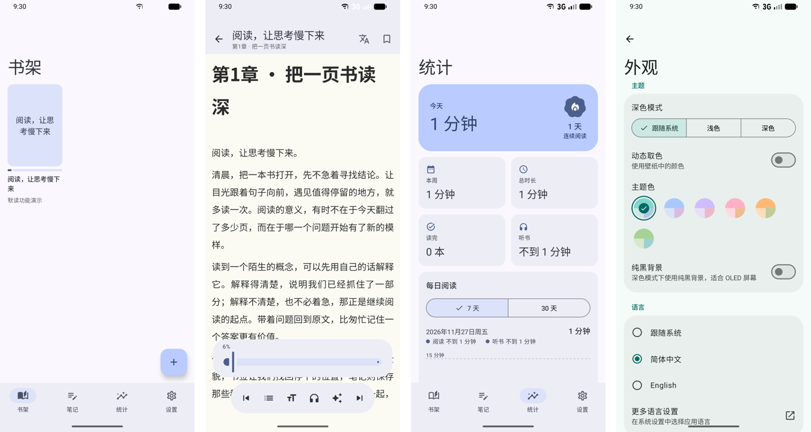

<h1 align="center">Zen Read</h1>

<p align="center">
  一款 Android 原生电子书阅读器，用 Kotlin、Jetpack Compose 和 Material 3 Expressive 构建。<br>
  An Android-native e-book reader built with Kotlin, Jetpack Compose and Material 3 Expressive.
</p>

<p align="center">
  <a href="https://github.com/Waverly-W/zen-read/releases/latest">下载 APK</a> ·
  <a href="ARCHITECTURE.md">架构说明</a> ·
  <a href="LICENSE">GPL-3.0-or-later</a>
</p>

<p align="center"></p>

## 功能

- **书库**：支持 EPUB、MOBI、AZW3、FB2、PDF、CBZ，阅读引擎为 [foliate-js](https://github.com/johnfactotum/foliate-js)。
- **排版**：可调字体、字号、行距、段间距、首行缩进、页边距和翻页方式；有多种页面主题，可下载中文字体或导入自己的字体。
- **标注**：划线、笔记、书签；笔记按书导出为 Markdown。
- **翻译**：选区翻译和段落双语对照，可用 Google、DeepL、Microsoft 或 AI 翻译。
- **听书**：支持系统 TTS、Edge 和 OpenAI 兼容服务；可在通知栏和锁屏控制，息屏后继续朗读，有定时关闭。
- **AI 阅读**：针对当前书对话、使用预设技能，用 RAG 检索整本书并给出引用位置。支持 OpenAI 兼容服务、Anthropic 和 Gemini，需要自备 API Key。
- **同步**：通过 WebDAV 或 S3 兼容存储在多台设备间同步书籍、进度和标注。
- **阅读统计**：统计阅读和听书时长、连续阅读天数，有每日柱状图、年度热力图和按书排行。
- **外观**：深浅色模式、动态取色、6 种主题色、纯黑背景；界面支持简体中文和英文。

## 安装

在 [Releases](https://github.com/Waverly-W/zen-read/releases/latest) 下载 APK 安装，需要 Android 8.0 及以上。

## 隐私

书籍、标注和统计数据都只存在本机。只有在你配置并使用相关功能时，应用才会联网：

- 翻译、AI、在线听书：把对应文本发给你选择的服务商。
- 同步：只连接你自己填写的 WebDAV 或 S3 地址。
- 下载字体：从字体的官方来源下载。

API Key 和密码用 Android Keystore 加密保存。应用不含统计或广告 SDK。

## 从源码构建

需要 JDK 17 及以上、Android SDK Platform 37.2 和 Build-Tools 37。

```bash
echo "sdk.dir=$HOME/Android/Sdk" > local.properties
./gradlew :app:assembleDebug        # 调试版
./gradlew test lintDebug            # 单元测试和 lint
```

模块划分、阅读引擎的注意事项和各功能的设计记录在 [ARCHITECTURE.md](ARCHITECTURE.md)。

## 来源与许可

Zen Read 是 [Modu Reader](https://github.com/sobranie2406/modureader) 的 Android 原生重写版。Modu Reader 源自 [Anx Reader](https://github.com/anxcye/anx-reader) 和 [ReadAny](https://github.com/codedogQBY/ReadAny)。感谢这些项目的作者和贡献者。本项目与上游项目没有隶属关系。

本项目以 [GPL-3.0-or-later](LICENSE) 发布。第三方组件的版权和许可见 [NOTICE](NOTICE)、[UPSTREAM.md](UPSTREAM.md) 和 [LICENSES/](LICENSES)，应用内也可以在「设置 → 关于 → 开源许可」查看。
